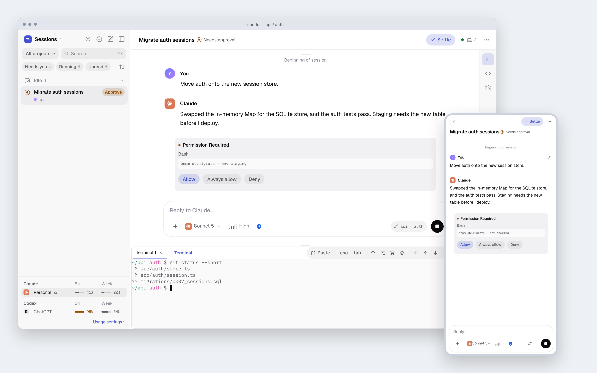
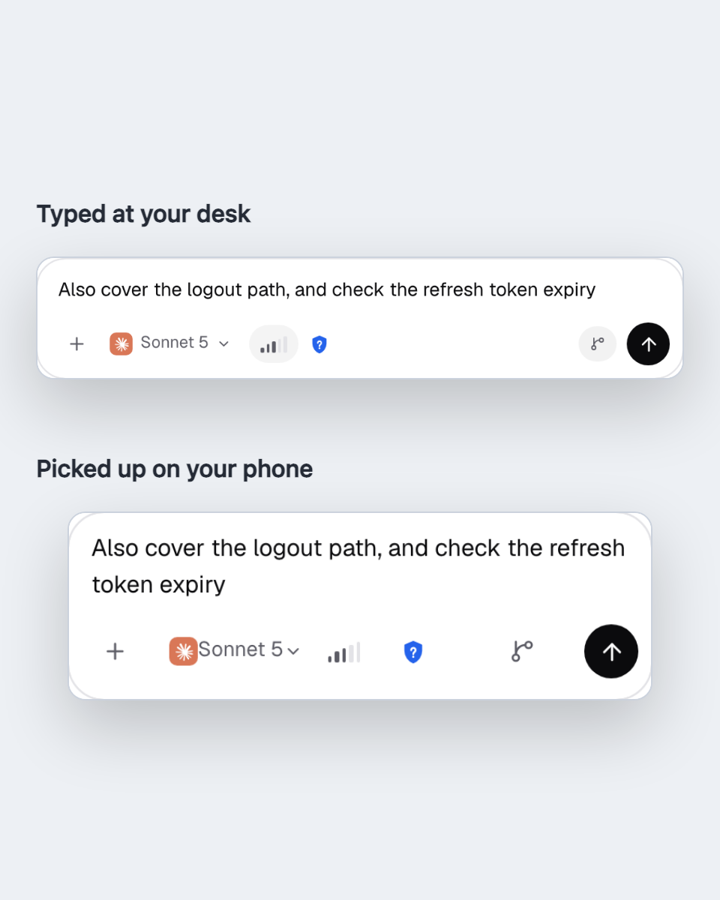
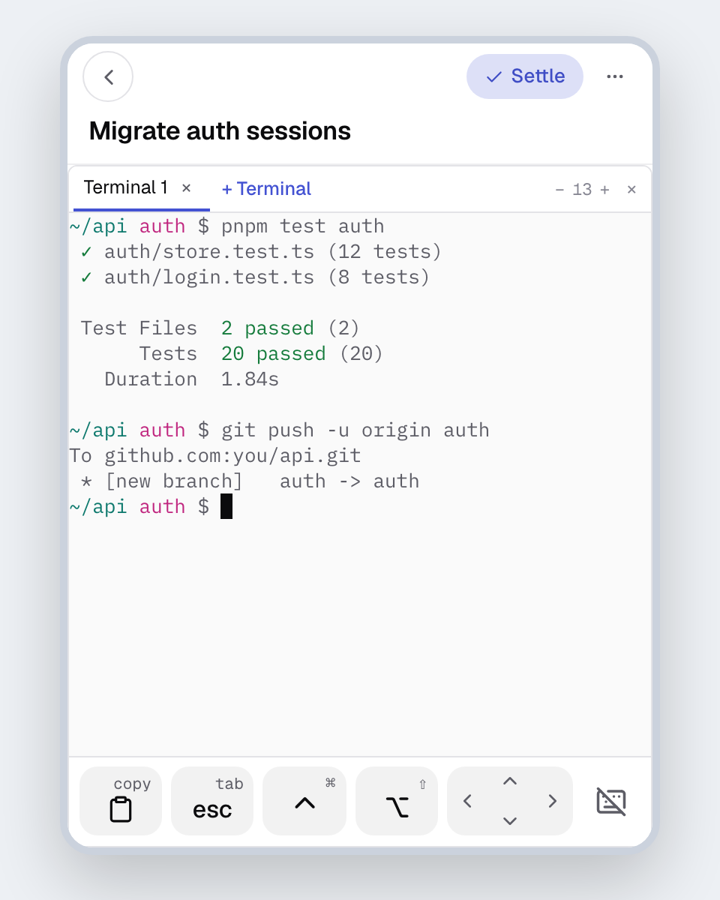
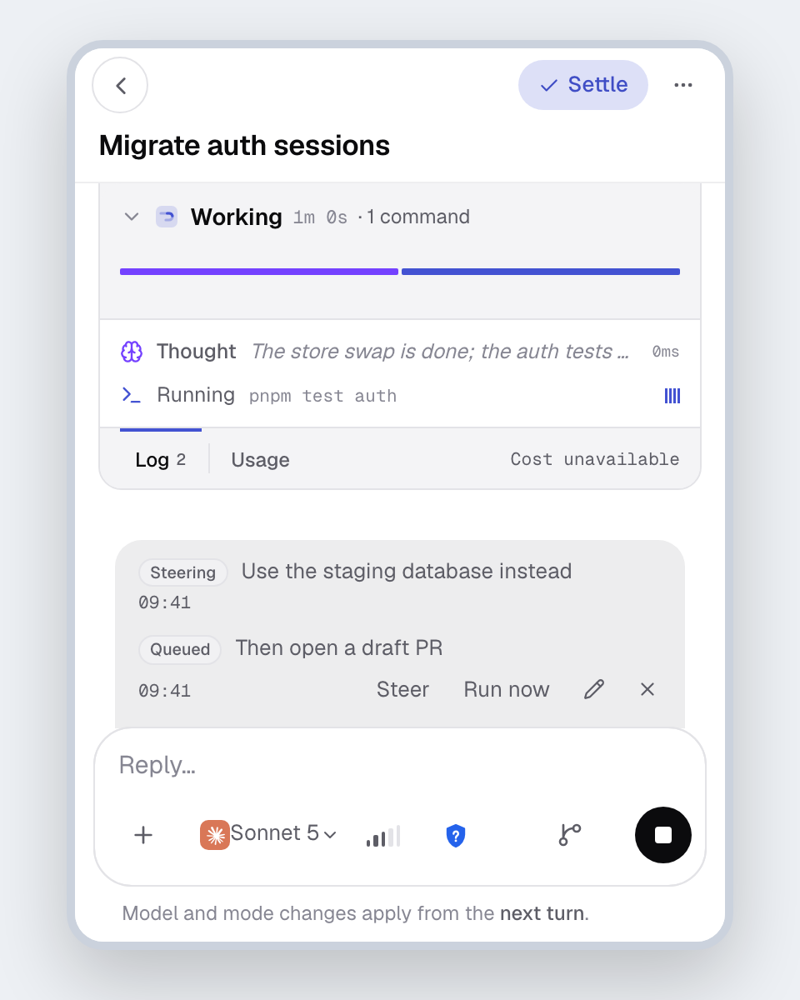
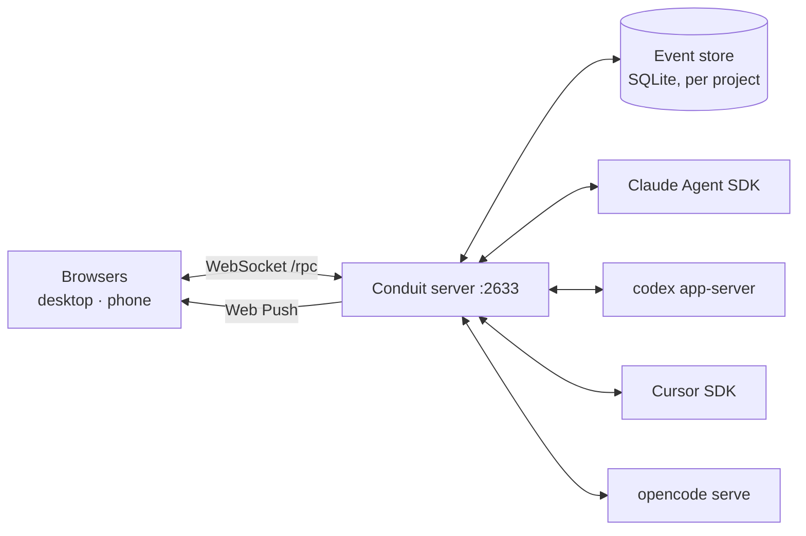

<p align="center">
  
</p>

<h1 align="center">conduit</h1>

<h3 align="center">Your agents keep working.<br>You keep moving.</h3>

<p align="center">
  An agentic IDE for Claude, Codex, Cursor and OpenCode,<br>designed for your desk and your phone.
</p>

<p align="center">
  <a href="#start">Install</a> ·
  <a href="#agents">Agents</a> ·
  <a href="#phone-setup">Phone setup</a> ·
  <a href="#cli">CLI</a> ·
  <a href="CHANGELOG.md">Changelog</a>
</p>

<picture>
  <source media="(prefers-color-scheme: dark)" srcset="media/readme/hero-dark.png">
  
</picture>

<table>
<tr>
<td width="33%" valign="top">
<picture>
  <source media="(prefers-color-scheme: dark)" srcset="media/readme/continuity-dark.png">
  
</picture>

**01 · Continuity**

Type half a message at your desk; it is already waiting on your phone. Every device opens the same transcript, draft and terminal.

</td>
<td width="33%" valign="top">
<picture>
  <source media="(prefers-color-scheme: dark)" srcset="media/readme/craft-dark.png">
  
</picture>

**02 · Craft**

A phone terminal built for thumbs: flick keys, locking modifiers, pinch to resize, a key row above the keyboard.

</td>
<td width="33%" valign="top">
<picture>
  <source media="(prefers-color-scheme: dark)" srcset="media/readme/control-dark.png">
  
</picture>

**03 · Control**

Steer, queue, branch, rewind, undo. Four agents, each on your own accounts.

</td>
</tr>
</table>

## Start

```bash
npx conduit-code   # Node 26.10+, from any project folder
```

That registers the folder as a project and prints its URL and a QR code. If no
server is running yet, it starts one in this terminal. Run it from another
folder to add that project to the same server; every project shares one port.

Install it globally (`npm install -g conduit-code`) to get the `conduit`
command used below. `conduit serve` runs the server in a terminal, and
`conduit service install` keeps it running at login on macOS and Linux.

Before you open Conduit to other devices, set a PIN: `conduit --pin <4-8 digits>`.

## Agents

Conduit drives four agents. You pick one per session in the composer, along
with its model and effort.

| Agent | Needs | Signs in with |
|---|---|---|
| **Claude** | Nothing extra; the Claude Agent SDK ships with Conduit | Your Claude Code login, or a folder you pick with `--claude-config-dir` |
| **Codex** | `codex` 0.160.0 or newer on your PATH | ChatGPT in the browser, a device code, or `OPENAI_API_KEY` |
| **Cursor** | Nothing extra; the Cursor SDK installs with Conduit | A browser login or `CURSOR_API_KEY` |
| **OpenCode** | `opencode` on your PATH | OpenCode's own config. Conduit uses a server already on port 4096, or starts its own and stops it after 10 idle minutes |

Each agent can have several accounts, such as Personal and Work, set up in
Settings → Providers. The sidebar shows plan usage for Claude, Codex and
Cursor, warns before a limit, and can hand a session to another account.

Some features depend on the agent. Goals work with Claude and Codex. OpenCode
queues messages you send mid-turn instead of steering. **Cursor runs tool calls
without asking**; its own sandbox is the boundary.

## Phone setup

Push notifications and the home screen app need HTTPS on every device except
the computer running Conduit, where `http://localhost` already counts as secure.

### With Tailscale (recommended)

Tailscale provides a real certificate and renews it, so phones need nothing
installed.

1. Once per tailnet, open the [DNS page](https://login.tailscale.com/admin/dns)
   in the Tailscale admin console and enable MagicDNS and HTTPS Certificates.
2. Start Conduit with Tailscale Serve:

   ```bash
   conduit serve --tailscale-serve
   ```

   Conduit stays on `127.0.0.1`, and Tailscale serves it at
   `https://<machine>.<tailnet>.ts.net:2633`. The setting is saved, so later
   starts and `conduit service install` keep it. `--no-tailscale-serve` turns
   it off and removes only Conduit's handler.
3. On your phone, open that URL or scan the QR code Conduit prints, then add it
   to your home screen.

Dev servers your sessions run get their own HTTPS address on your tailnet,
behind the same Conduit login.

Home screen apps and push subscriptions belong to one exact address. If you
used Conduit from another address before, add the app again from the new one
and turn notifications back on. Tailscale certificates are public, so your
machine and tailnet names appear in
[certificate transparency logs](https://tailscale.com/kb/1153/enabling-https).

### On your LAN, without Tailscale

Install [mkcert](https://github.com/FiloSottile/mkcert):

```bash
brew install mkcert && mkcert -install
```

`conduit serve` then creates a certificate and listens on every network
interface, so phones on your LAN can reach it. To trust the certificate on a
phone, open the setup address Conduit prints (`http://<ip>:<port+1>/setup`).

### Notifications

Conduit sends a push when a turn finishes, fails, asks you a question, needs a
permission, or a goal gets stuck. Tapping one opens that session, where you
answer or approve. A tab you are looking at plays a sound instead.

## Security

**With no PIN, anyone who can reach the address can use Conduit.** Set one with
`conduit --pin <4-8 digits>`. Five wrong tries lock sign-in for 15 minutes, a
browser stays signed in for 24 hours, and changing the PIN signs every browser
out.

Conduit listens on `127.0.0.1` unless you set `--host` or `HOST`, or a mkcert
certificate is in use, which makes it listen on every interface. Tailscale
Serve keeps it on loopback.

Requests from other websites are refused, over both HTTP and WebSocket. The
CLI talks to the server through a Unix socket only your user can open, and
config files are written owner-only.

Don't expose Conduit to the public internet. For remote access, use
[Tailscale](https://tailscale.com) or a VPN.

## CLI

```
Usage: conduit [command] [options]

  With no command, registers the current directory and prints its server URL,
  starting the server in this process first if none is running.

Commands:
  serve                 Run the server in this process until stopped
  stop                  Shut down the server and its managed processes
  service install       Install a launchd/systemd user service (accepts server options)
  service uninstall     Stop and remove the user service
  service status        Show service state, PID and log paths
  doctor                Check registered projects' shell env and tools locally
  server mark <port> --serving|--awaited
                        From an agent's shell: declare a server the session runs

Options:
  --status              Show server status
  --stop                Alias for stop
  --pin <PIN>           Set/update PIN (4-8 digit)
  --add <path>          Add project by path
  --remove              Remove current project
  --list                List all projects
  --title <name>        Set project display title
  --instance <action>   Manage OpenCode instances
                        Actions: list, add, remove, start, stop, status
                        Managed:   --instance add work --port 4097 --managed
                        Unmanaged: --instance add remote --url http://host:4096
  -p, --port <port>     HTTP server port (default: 2633, 0 picks a free port)
                        When used with --instance, sets the instance port
  -H, --host <addr>     Bind address (default: 127.0.0.1, or HOST env var)
  --oc-port <port>      OpenCode server port (default: 4096)
  --claude-config-dir <path>
                        Claude Code config dir (CLAUDE_CONFIG_DIR) for Claude
                        sessions; persisted in daemon.json for future starts
  --managed             Mark as managed (spawned by relay-daemon; used with --instance add)
  --url <url>           External URL for unmanaged instances (used with --instance add)
  --log-level <level>   Set log level: error, warn, info (default), verbose, debug
  --log-format <format> Set output format: pretty (default), json
  --no-https            Disable TLS
  --tailscale-serve     Serve HTTPS on your tailnet through Tailscale Serve;
                        persisted in daemon.json for future starts
  --no-tailscale-serve  Turn Tailscale Serve off and remove Conduit's handler
  -h, --help            Show this help
```

Environment variables: `HOST`, `CONDUIT_CONFIG_DIR`, `XDG_CONFIG_HOME`,
`OPENCODE_URL`, `OPENCODE_SERVER_USERNAME`, `OPENCODE_SERVER_PASSWORD`,
`CONDUIT_CODEX_BINARY`, `CURSOR_API_KEY`, `LOG_LEVEL`, `LOG_FORMAT`.

Config lives in `~/.config/conduit`, or `$XDG_CONFIG_HOME/conduit`, or
`CONDUIT_CONFIG_DIR`.

### Run as a user service

```sh
conduit stop                          # Fully stop a running server first
conduit service install --port 2633
conduit service status                # Installed/loaded/running state, PID and log paths
conduit service uninstall             # Stop the service and remove its unit
```

The service runs `conduit serve` through your login shell (`$SHELL -l -c`), so
put tools it needs in your login-shell startup files. It keeps the working
directory and server flags from install time; to change flags, uninstall and
reinstall. macOS uses `~/Library/LaunchAgents/dev.conduit.server.plist`, Linux
uses `~/.config/systemd/user/conduit.service`. Logs are `service.stdout.log`
and `service.stderr.log` in the config directory, and uninstall keeps them.

## Architecture



One server hosts every project on one port. Conduit owns the state: each
project's sessions, messages and drafts live in a SQLite event store, and the
agents are execution engines that stream events into it. That is why every
device sees the same session.

It is also why the server can restart mid-turn. Claude, Codex and Cursor
runners, terminals and managed OpenCode keep running when `conduit serve`
stops, and the next start picks them up again.

## FAQ

<details>
<summary>Common questions</summary>

**Does my code leave my machine?**
Conduit runs on your computer and your files stay there. The only traffic out
is each agent's own API calls, the same as its CLI. Optional message surfacing
(off by default) sends turn messages to TypeSafe's API to sort them.

**Is this a terminal wrapper?**
No. Conduit drives each agent through its SDK or app-server protocol, never by
reading terminal output.

**Do I need OpenCode?**
No. Any one of the four agents is enough.

**Do I need mkcert?**
No. The computer running Conduit works over plain `http://localhost`. Other
devices need HTTPS for push and the home screen app: use
`conduit serve --tailscale-serve`, or mkcert on a LAN.

**What happens if the server stops or crashes?**
Running turns, terminals and managed OpenCode keep going, and the next
`conduit serve` picks them up and replays any steered or queued messages. An
installed service restarts the server for you. `conduit stop` shuts everything
down.

**The CLI says the server is from another build.**
After an upgrade, run `conduit stop`, then `conduit serve`.

</details>

## Contributing

```sh
mise trust && mise install   # Node 26.10.0 and pnpm 11.17.0
pnpm install
pnpm dev:all
```

`pnpm dev:all` rebuilds on save and restarts the running Conduit; sessions keep
running through restarts. If no service is running, it starts its own server.
It also runs Vite (usually http://127.0.0.1:5173) for instant UI hot reload
against that server. For a child server, pass options with
`pnpm dev:all -- --port 2700`.

Bug fixes are welcome. For features, please
[open an issue](https://github.com/dibstern/conduit/issues) first. If you use
Conduit, tell us how in
[Discussions](https://github.com/dibstern/conduit/discussions).

## Thanks

Conduit exists because of [Clay](https://github.com/chadbyte/clay), which put
Claude Code in the browser on any device, with push notifications and mobile
approvals. Conduit started from Clay's approach and grew from there.

## Disclaimer

Independent project, not affiliated with Anthropic, OpenAI, Cursor or the
OpenCode project.

Conduit is provided "as is" without warranty of any kind. You are responsible
for complying with the terms of service of the AI providers and other services
you use with it, including their rules on account sharing and rate limits. The
authors assume no liability for misuse or violations arising from its use.

## License

[MIT](LICENSE)
